# AC Rally StageSwitch

**Automatically apply the force feedback (FFB) gain and render resolution scale you choose for each stage in Assetto Corsa Rally.**

Set a baseline for the whole rally, then fine-tune individual stages. You can also give a car its own FFB gain on a
particular stage. Render resolution scaling is optional.

> **A hobby project.** I built StageSwitch in my spare time because I wanted my FFB gain and render resolution
> to switch automatically when I loaded a different stage. I make it independently and share it for free.
> See [Disclaimer](#disclaimer).

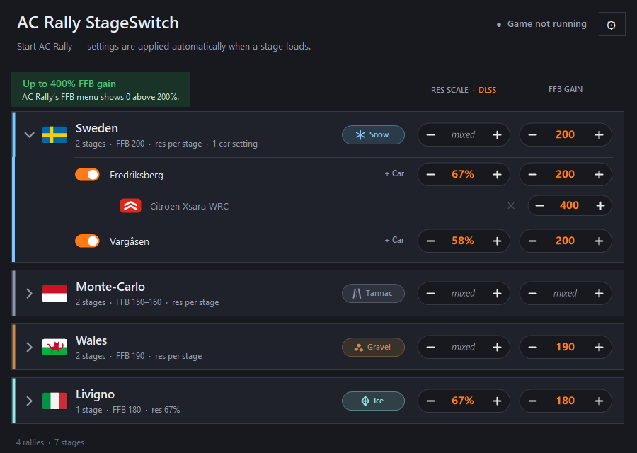

---

## Why you'd want this

The same force feedback setting can feel different on a fast gravel stage, a tight tarmac stage, or in another car.
If you find yourself changing the gain in the game menu before each run, StageSwitch lets you save those values
once. When you load a stage, it applies the value you picked for it.

You can do the same with graphics. A lower render resolution scale can help on a demanding stage, and you can use a
higher one where your PC has room to spare.

## What you get

### A gain for the whole rally or one stage

StageSwitch finds the stages in your game files and checks for new ones when you start StageSwitch or the game.
Click a rally to open its stage list. Set the bold rally row to give all its stages the same starting value, then
adjust any stage you want. Use **−** and **+**, or click the number to type an FFB gain from **0% to 400%**. Turn off a stage's
switch to skip automatic changes there.

**Above 200%.** AC Rally’s FFB gain menu supports values up to 200% and shows **0** for higher gains.
StageSwitch still applies the selected gain. Check the actual value in StageSwitch or its stage-load popup.

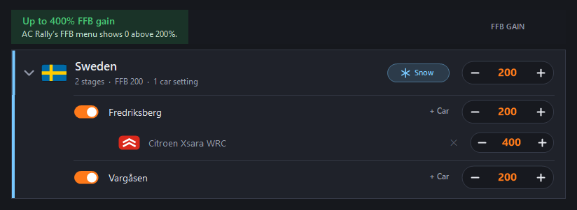

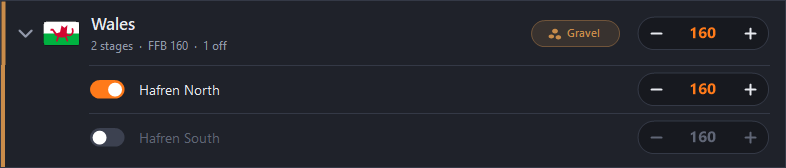

### A gain for a particular car

Open **Settings** with the gear icon and turn on **Different gain per car**. Click **+ Car** on a stage and pick
the car you want to tune. In this example, the Subaru Impreza S3 uses **135** on Sisteron and cars without their
own setting use **150**. Click **×** beside a car to go back to the stage value.

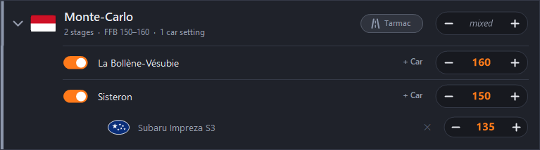

### A different render resolution for each stage

Open Settings and turn on **Resolution scale per stage** (off by default) to show the **Res scale** column.
Set a value for the whole rally or for each stage. With TSR, FSR or XeSS you can enter a value from **33% to 200%**.
With DLSS the controls step through the game's presets, such as **58% Balanced**, **67% Quality** and **100% DLAA**.

On my PC, **Hafren South** is the most demanding stage. I set it to **DLSS Performance (50%)** to match the frame
rate I get on the other stages. StageSwitch applies 50% when Hafren South loads and switches to the saved value
for the next stage automatically.

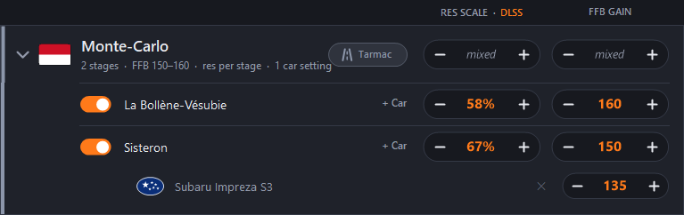

If the game's own DLSS setting is **100% (DLAA)**, lower it to **67%** in the game and press **Apply** so
StageSwitch can switch between presets. You can still choose **100%** for a stage in StageSwitch.

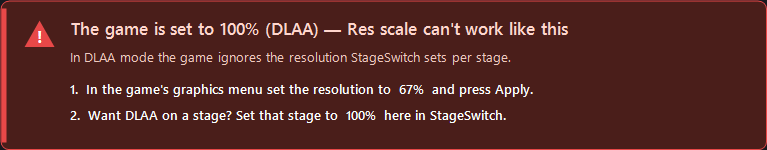

### A popup when your settings are applied

When a stage loads, a popup confirms the gain and shows the resolution scale if you enabled it. The popup lasts
**10 seconds** by default. It works in borderless or windowed mode, and you can turn it off with **Show popup in
game** in Settings. If you edit the active stage in StageSwitch, the change applies during that run.

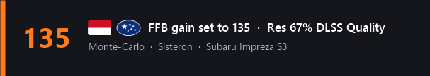

### Learn from changes you make in the game

With **Learn from in-game changes** on (the default), you can fine-tune FFB in the game's own menu during a run.
StageSwitch saves the new gain for that stage, or for the car you're driving on that stage if per-car gains are
on. It can also learn resolution changes when **Resolution scale per stage** is enabled. It watches for changes
while you're on a stage, so you can still adjust your general settings from the game's main menu.

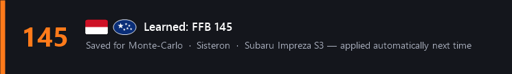

### Save a recommendation from MozaHud

[MozaHud](https://github.com/fbenniks/acr-mods-moza-hud) is StageSwitch's companion app for MOZA wheelbases.
It measures clipping as you drive and suggests an FFB gain after the stage. Keep both apps open, select the run in
MozaHud and click **Apply in StageSwitch…**. You can use the gain for this car on this stage,
this car across the rally, the stage default, or all stage defaults in the rally.

StageSwitch saves your choice and uses it the next time you load the stage. You can see the new value in the
stage list. If you're already on the affected stage, it can apply the value during the run. Choosing a default
clears any overrides for the car from that run on the affected stages so it uses the new default.

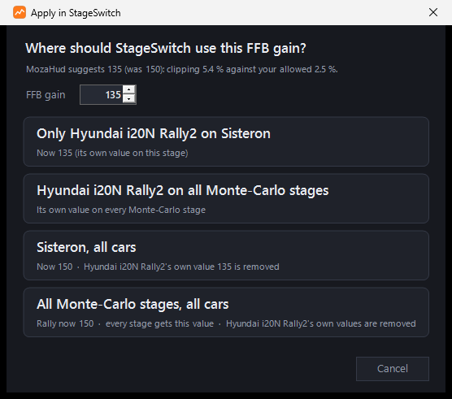

---

## Getting started

**You need** a 64-bit Windows PC and Assetto Corsa Rally. MozaHud is optional.

1. **Download** [ACRallyStageSwitch.exe](https://github.com/fbenniks/acr-mods-stageswitch/raw/refs/heads/main/ACRallyStageSwitch.exe)
   and put it in a folder of its own. It's a single file with no installer.
2. **Run StageSwitch.** It looks for your AC Rally install and loads the stage list. If the list is empty, open
   **Settings → Game folder → Change…** and pick the **Assetto Corsa Rally** install folder.
3. **Open a rally and set a gain** for the stage you want to drive. Then start the game and load that stage.
4. **Optional.** Open **Settings** to enable car-specific gains, per-stage resolution, **Start with Windows**, or
   **Start minimized to tray**.

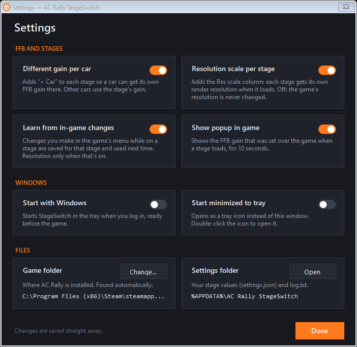

Closing or minimizing the window keeps StageSwitch running in the Windows system tray. Double-click its icon to
bring it back, or right-click and choose **Exit** to quit.

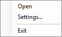

## Good to know

- **Starting values.** Check the gains before your first run. On a fresh scan the app starts Wales at 200,
  Monte-Carlo at 160 and the other rallies at 100. Adjust them for your wheel and taste.
- **Stage switched off?** StageSwitch skips automatic changes there. If learning is on and you change a
  supported setting in the game's menu while driving that stage, StageSwitch saves it and turns the stage back on.
- **Where are my settings?** **Settings → Settings folder → Open** takes you to the local folder with
  **settings.json** and **log.txt**. Your stage settings stay on your PC.
- **After a game update.** If StageSwitch has trouble applying a setting, check the status in the main window
  or the log in the settings folder.

## How it works

For stage detection, settings storage, the MozaHud connection and build instructions, see
[How it works](docs/HOW-IT-WORKS.md).

## Disclaimer

AC Rally StageSwitch is a personal hobby project, made in my spare time for other sim-rally fans.

- I develop and share StageSwitch independently, without affiliation, sponsorship, endorsement or payment from
  the makers or publishers of Assetto Corsa Rally, MOZA Racing or anyone else.
- It is an **unofficial** tool. It reads information from the game and applies your chosen FFB gain and optional
  render resolution scale while the game is running.
- It's provided **as is, without any warranty**. You use it at your own risk.
- Product names, logos and brands belong to their respective owners. They identify the products and features
  shown in the app and in this guide. The screenshots show example settings.
